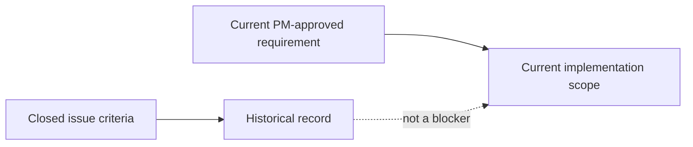

# Agent instructions

akc.io is an event management product, developed as a pnpm monorepo with two apps.

- `apps/backend` — NestJS + Prisma + Postgres. Auth: BetterAuth (mounted at `/api/auth/*`, treat as a black box). API docs: Swagger at `/api/docs`.
- `apps/frontend` — React + Vite + TanStack Router/Query, Tailwind + shadcn/ui, `ky` + `zod` API client. Feature folders under `src/features/`.

Organize backend features into controllers, DTOs, services, domain models and repositories. Organize frontend features into API schemas, query options, hooks and components. Keep shared infrastructure outside feature folders.

**Before writing or changing any UI, read [`DESIGN.md`](DESIGN.md).** It is the akc.io design system: tokens, components and how to add them (#79).

## Story context

Before implementing a story, read its active GitHub issue and sprint decisions. Identify the access area (public, participant, organization or event), data scope, existing destination and entry/exit paths before choosing routes or adding screens. The active story defines scope unless the PM gives a later, explicit direction.

When the PM approves a requirement that conflicts with a closed issue's acceptance criteria, follow the current requirement. Closed issues record historical scope; their criteria do not block later changes. Track the current decision in the active issue or PO feedback tracker. Do not reopen or edit a closed issue just to reconcile its old criteria unless the PM asks.

Reuse the relevant existing page. Report conflicts or proposed structural changes to the PM before changing the navigation structure. For active stories, GitHub issue titles and bodies are the source of truth, including navigation context. Local Markdown copies are private PM working material, ignored by Git; they are not required for implementation and must not override the active issue.

## Architecture decisions

Significant architectural decisions are recorded as ADRs in [`docs/adr/`](docs/adr/README.md); its README says when one is needed and how it is accepted.

- Before designing a change, check the accepted ADRs for its area and follow them. A conflict with an accepted ADR is a structural change: report it to the tech lead (architecture) instead of working around it.
- When your work makes a decision that meets the README's criteria, propose an ADR with status `Proposed` from [`docs/adr/template.md`](docs/adr/template.md), in the PR that introduces the decision or before it, and point the tech lead to it.
- Set an ADR to `Accepted` only when its text is final and ready for an approving PR review from a code owner of `docs/adr/` as listed in [`CODEOWNERS`](.github/CODEOWNERS). The PM may review product-scope decisions but is not a code owner. Never approve it or claim acceptance yourself. Any later change to the file needs a fresh approval. Do not rewrite an accepted ADR: supersede it with a new one.

## Commands

- `pnpm dev` — everything: env files, Postgres (Docker), migrate, run the seed entry point, both dev servers
- `pnpm storybook` — launch the frontend Storybook on port 6006
- `pnpm check-all` — lint + type-check + unit tests + build, the same as CI's checks lane (CI also validates migrations and database constraints)
- `pnpm check-stories` — every story in Chromium + Storybook build
- `pnpm e2e:affected` — the Playwright E2E specs the change affects (`--list` shows them, `--all` runs everything)
- `pnpm backend test` / `pnpm frontend test:ci` — unit tests
- `pnpm backend prisma:migrations:run` — create/apply migrations after schema changes

## Product identity and compatibility

Use `akc.io` as the product name in UI, emails, API metadata and documentation; use `akcio` where a technical identifier cannot contain a dot. This repository implements akc.io and is not a reusable starter.

Every page must display the akc.io icon and wordmark together in its header or dashboard sidebar. Reuse the shared `BrandMark` component (`apps/frontend/src/components/BrandMark.tsx`), including in previews; do not replace the logo with plain text or a generic icon. Keep icon size and spacing relative to the wordmark font size so their proportions scale together, and prevent the icon from shrinking or the wordmark from wrapping.

Do not retain or introduce backward compatibility for previous product names, starter behavior or superseded internal contracts. Remove obsolete aliases, shims, fallback branches and transitional code when replacing them; update all affected callers and configuration to the current contract. Do not rename external resources without verifying their actual identity.

## Conventions

Deliberately sparse — this file grows as the team learns what it expects from generated code. Add rules here when you find yourself repeating the same review feedback.

When updating notes on PO or teacher feedback, keep each note concise and factual: add one status label, then state the team decision or current status in one or two sentences. Use only these labels: `Hotovo`, `Rozpracováno`, `Zamítnuto` and `Čeká`. Use the team’s voice; do not attribute decisions to or name individuals. Omit implementation details already visible in the UI or Storybook and conversational history.

### Sync with main before starting an issue

Before starting work on an issue, read its body and labels. Then fetch the latest `origin/main`, create the branch from it, or merge it into an existing working branch. Resolve merge conflicts before implementation and preserve unrelated local changes.

### User stories are owned by the PM

User stories are read-only for agents by default. Only David, acting as PM, may explicitly authorize an agent to create, edit, delete, regenerate, import or synchronize user stories. A request to implement a story, fix code, update documentation or complete a feature is not authorization to change the story.

This rule covers private local stories in `docs/user-stories/` and `docs/sprints/*/stories/`, their requirements, acceptance criteria, scope, priorities and approval metadata, the source feature workbook, and corresponding GitHub issue titles and bodies. Do not run `docs/user-stories/import.py --execute` without explicit PM authorization, because it writes story content to GitHub.

If implementation reveals a gap or conflict, report it to the PM and propose a change in your response; leave the story unchanged. When the PM explicitly requests story changes, make only the authorized changes. Reading stories and reporting implementation progress remain allowed.

### Issue structure and backlog refinement

When the PM authorizes story creation or refinement, keep issues concise and use these sections:

- `User story` — who needs what and why.
- `Akceptační kritéria` — observable, verifiable completion conditions, including relevant empty and error states.
- `Podklady` — optional references such as screenshots, audit findings or an existing screen to follow.
- `Mimo rozsah` — include only when needed to clarify boundaries.

Keep navigation context to a concrete destination where needed (for example, `Umístění: správa akce → Pokoje`). Shared background and source materials can remain on the parent issue. Keep the GitHub issue template short; workflow instructions belong here rather than in template comments. Resolve outstanding product decisions with the PM before dependent implementation and incorporate the agreed behavior into the acceptance criteria. Do not add an `Otevřené otázky` section. Avoid provenance prose, duplicate status information and separate `Stav refinementu` sections. Track status and sprint assignment in GitHub Projects.

Select existing product backlog issues for a sprint directly when their whole scope fits; do not create sprint-specific copies. When a broader requirement needs splitting, retain it as a parent issue and use GitHub's native parent/sub-issue relationship for independently acceptable product outcomes. Preserve deferred acceptance criteria in open sub-issues in Product Backlog without a sprint. Assign selected sub-issues to the sprint; keep the parent open without a sprint until its full retained scope is delivered and accepted. Do not duplicate relationship links or explanatory comments manually. A completed sprint slice does not complete its broader parent; removing a requirement requires an explicit PM decision.

### UI rules

Frontend stack (`apps/frontend`): Vite + React 19, Tailwind v4, shadcn/ui, TypeScript.

- Before building UI, look up existing components through the shadcn MCP or `pnpm dlx shadcn@latest docs <component>`. Add missing ones from `apps/frontend` with `pnpm dlx shadcn@latest add <name>`. Never hand-roll a primitive shadcn provides. In this monorepo, shadcn CLI commands run from the root need `-c apps/frontend`.
- A freshly added `src/components/ui` file can fail the token rules (upstream arbitrary values). Report those findings to the developer instead of editing the file or the lint config.
- Semantic tokens only (`bg-background`, `text-muted-foreground`, `bg-destructive`, …). No raw palette colors, arbitrary values (`p-[13px]`) or inline styles.
- Pages control layout only. Appearance comes from component variants and sizes; if none fits, ask instead of restyling with `className`.
- Do not, without asking the developer: add theme tokens, add lint-disable comments, edit the lint config (including `SHADCN_LEGACY_FILES`), or edit `src/components/ui` just to make a violation go away.
- UI is implemented directly from the issue and [`DESIGN.md`](DESIGN.md); there is no separate design-preview step. Follow the existing screens of the same area.
- After any UI change, run `pnpm check` and the story files you touched (`pnpm frontend test:stories <path>`) and fix every error before finishing. CI runs every story on the PR.

### Storybook

Storybook (`pnpm storybook`) covers shared components, reused UI patterns and the states where UI tends to break; it is not a catalogue of every screen.

- **What gets a story.** A shared component or reused pattern, with its relevant variants and risky states: error, loading, empty, long content, mobile. A new page or feature needs no story unless it brings such a component or state. A whole screen may be added for a concrete design, consultation or showcase need.
- **Same components as the app.** Screen stories render the real route through `ScreenPreview`; component stories render the component itself. Do not maintain copies of screens only for show: a design preview made for a concrete need is replaced by the real screen once it is implemented, or removed when its direction is dropped.
- **Keep covered stories current.** When you change a component or screen that has stories, update them in the same PR. There is no separate design or approval step in Storybook.
- **Remove without losing checks.** When deleting or merging a duplicate or obsolete story, move its important `play` checks into the remaining story or a test.
- **Data and checks.** Fixtures are parsed with the feature's zod schemas and served through MSW; an API request without a handler fails instead of reaching the backend. `pnpm frontend test:stories` renders every story in Chromium with its `play` checks and the accessibility check, and agents run it through the Storybook MCP server too. While iterating, run only the affected file (`pnpm frontend test:stories <path>`).
- **Sidebar.** `Foundations` (tokens and the kit), `Components` (shared components and patterns), `Screens` (by access area) and `Brand` (brand directions).

### UI controls come from the kit

Need a control that isn't in `src/components/ui/`? Add it with `pnpm dlx shadcn@latest add <name>` — don't hand-roll one in a feature folder, even where a native input would do the job. One accessibility implementation to reason about beats a per-control judgement call.

Use semantic tokens from `apps/frontend/src/styles/global.css` and follow the project requirements in `DESIGN.md`.

### The app is already running

Assume the dev servers are up. If something is listening on the app's ports, that is this application: use it. Don't start a second instance, don't restart it, don't run `pnpm dev`.

Don't reach for the browser to check your own work. Tests and type-checks are the evidence; open the running app when asked to, not on your own initiative. The exception is taking screenshots for a PR (see [PRs handling](#prs-handling)).

### Check what you changed

Before you commit, push or open a PR, run the checks that fit the change and fix every failure: `pnpm check` for frontend work, `pnpm backend test` for backend work, `pnpm backend test:db` for repositories and migrations, the story files you touched, and `pnpm e2e:affected` when a flow can be affected. Run Prettier and lint through each app's scripts, not from the root, because each app has its own config. `pnpm check-all` and `pnpm check-stories` are available but not required before every commit: CI runs every lane on every PR, and the merge queue runs the whole E2E suite before anything reaches `main`. When a change alters UI labels, flows or an API contract, update the E2E and database specs that still use the old behaviour, and give a new E2E spec its areas in `scripts/e2e/select.mjs`.

Run `pnpm backend test:db` after, not before, an E2E run: it shares the local database and leaves queued evaluations that slow the next E2E run down.

### Delivery

The rules are in [`docs/delivery-workflow.md`](docs/delivery-workflow.md), [ADR-0005](docs/adr/0005-native-github-delivery.md) and the proposed [ADR-0007](docs/adr/0007-codeowners-guide-review-routing.md); role-based ownership is proposed in [ADR-0006](docs/adr/0006-role-based-code-ownership.md).

- Never commit or push to `main`. Deliver an issue with one PR into `main`; split an issue that is too big into smaller issues. Do not use stacked PRs or integration branches.
- A merge needs CI (`verify`) on the current commit, one approval of the latest push from someone other than the author and last pusher, and resolved conversations. Any eligible teammate may approve; `CODEOWNERS` guides default QA assignment but does not add an approval gate. It goes through the merge queue, which runs the whole E2E suite on the merge result.
- QA approves the PR's current commit after testing it ([Local QA](docs/local-qa.md)). The notifier asks Matej for PRs from others; Matej's own PRs route to a reviewer by changed area. It never blocks.
- `/review` on a PR runs an optional, advisory Copilot review. Never post approvals, reviews or `/review` on someone's behalf unless asked.

### PRs handling

Use `.github/pull_request_template.md` as the starting point for PR descriptions. Keep the body concise and written for a reviewer who has not seen the conversation:

- `What`: describe the concrete problem and resulting behavior in one or two sentences; scale detail to the change.
- `Why`: link the story or issue. Use `Closes #N` only when the PR completes that issue; use `Refs #N` for partial work or a broader parent that remains open.
- `How to test`: include actionable reviewer steps when useful. Do not fill this section with agent verification logs, routine successful checks (`pnpm check-all`, formatting, link checks, `git diff --check`) or file inventories. CI reports routine automated results; mention failures or verification limitations only when they affect the review.
- `Screenshots`: include relevant visuals for UI changes when available; do not fabricate evidence. For UI work, capture them from the running app (not Storybook) with a throwaway Playwright script that is not committed; show the relevant states, including errors. Commit the images to `docs/screenshots/<story-id>/` on the PR branch itself, without a separate assets branch, and embed them in the PR body with `https://github.com/<owner>/<repo>/blob/<commit-sha>/docs/screenshots/<story-id>/<file>.png?raw=true`. The commit counts as a new commit for review and QA.

Code reviews must evaluate the PR's declared scope as well as its linked story. Treat the PR title and `What`/`Why` sections as the author's description of the slice being delivered, and use the issue for product context and relevant criteria. `Refs #N` explicitly means partial work: missing behavior that the PR says is deferred is not a blocker just because the broader issue requires it. `Closes #N` claims completion, so review the full issue scope. For either link type, block concrete regressions and defects in behavior the PR claims to deliver; do not infer that an inert or mocked design preview must persist data or call a backend when the PR explicitly says implementation comes later. If the PR's declared scope conflicts with the issue or is too vague to review, report the conflict as a note or ask the author to clarify instead of silently expanding the PR's scope.

Keep the template headings (`What`, `Why`, `How to test`, `Screenshots`), including for small documentation PRs. Keep each section brief; where a section does not apply, state that concisely rather than removing the heading. Remove template comments. Describe the final scope, without conversational history or abandoned approaches. Keeping routine check results out of the PR body does not waive running the checks that fit the change.
