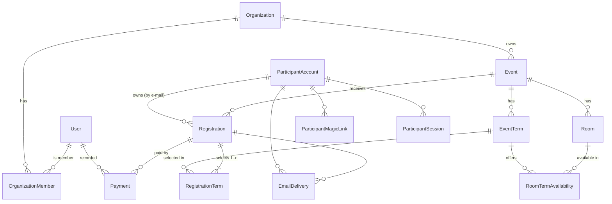

# akc.io — data model

Design for **S2-T1 ([#74](https://github.com/applifting-vsecourse/team-4/issues/74))**:
entities, relations, constraints and sources of truth for Sprint 2, plus how the model
grows into the full MVP backlog. Status: **proposal for review**. It is not
implemented and has no migration yet. The Prisma schema in §7 passes `prisma validate`
against the current auth models. Its generated SQL, together with the hand-written
constraints in §8, was applied to a scratch Postgres 17 database. Smoke tests confirmed
that the database rejects overlapping terms, zero-bed rooms, cross-event room
availability, cross-organization payments, opening without `firstOpenedAt` and a second
registration per e-mail, and that the VS default comes from the sequence.

Context: [Sprint 2 decisions](../sprints/sprint-2/README.md) ·
[T1 scope](../sprints/sprint-2/delivery.md#t1--společný-datový-model-a-migrace).

## 1. Requirements the model must satisfy

| #   | Requirement                                                                                                                                                                                         | Source            |
| --- | --------------------------------------------------------------------------------------------------------------------------------------------------------------------------------------------------- | ----------------- |
| R1  | An organizer owns several organizations. All data belongs to exactly one organization, and foreign data is unreachable for reads and writes.                                                        | S2-02, S2-03, F41 |
| R2  | An event has terms with calendar dates (both ends inclusive), a price in CZK (≥ 0) and **no overlap** within the event.                                                                             | S2-04             |
| R3  | Event name, description, location, terms and prices are locked from the first opening onward.                                                                                                       | S2-04, S2-06      |
| R4  | Rooms belong to one event, have a unique label, a positive bed count and availability per term. Capacity of a term = Σ beds of rooms available in it.                                               | S2-05             |
| R5  | Room edits must not drop any term's capacity below its confirmed count.                                                                                                                             | S2-05             |
| R6  | A registration is always saved. Each selected term is independently _confirmed_ (consumes a bed) or _waitlisted_ (consumes nothing). There is **no aggregate status that hides a mixed result**.    | S2-08, T1         |
| R7  | Concurrent submissions never confirm more people than the capacity.                                                                                                                                 | S2-08, F53        |
| R8  | One registration per e-mail per event. Retrying a lost request creates no duplicate.                                                                                                                | S2-08             |
| R9  | Each registration has a unique VS, one amount due (Σ confirmed term prices) and one due date (confirmation + N days). It keeps the bank account and due-day settings in force when it was received. | S2-09             |
| R10 | Payments: positive CZK amount with ≤ 2 decimals, received date, no duplicates on double submit, immutable. Balance can be debt, settled or overpaid.                                                | S2-12             |
| R11 | Participant accounts are separate from the personal data on each registration. One account per e-mail, created only once a registration exists.                                                     | S2-13, T1         |
| R12 | Magic links last 15 min and are single use. Participant sessions last 7 days and can be revoked. They never grant organizer access. Tokens are never exposed.                                       | S2-13             |
| R13 | Confirmation e-mail failures are recorded and traceable. Provider acceptance is not reported as delivery.                                                                                           | S2-15, T3         |
| R14 | Do not break the existing BetterAuth model.                                                                                                                                                         | T1                |

## 2. Entity overview



| Entity                                          | Table                                            | Purpose                                                                                           |
| ----------------------------------------------- | ------------------------------------------------ | ------------------------------------------------------------------------------------------------- |
| `User` (+ `Session`, `Account`, `Verification`) | existing                                         | BetterAuth organizer identity. Unchanged apart from back-relations.                               |
| `Organization`                                  | `organization`                                   | Tenant.                                                                                           |
| `OrganizationMember`                            | `organization_member`                            | User ↔ organization with a role. Sprint 2 has only `owner`.                                       |
| `Event`                                         | `event`                                          | Event, lifecycle state, payment configuration for **new** registrations.                          |
| `EventTerm`                                     | `event_term`                                     | Dated run with price. Named _EventTerm_ so it does not collide with "terms and conditions" (F07). |
| `Room`                                          | `room`                                           | Accommodation unit with a bed count.                                                              |
| `RoomTermAvailability`                          | `room_term_availability`                         | Which rooms count towards which term's capacity.                                                  |
| `ParticipantAccount`                            | `participant_account`                            | Participant identity = normalized e-mail.                                                         |
| `ParticipantMagicLink` / `ParticipantSession`   | `participant_magic_link` / `participant_session` | Passwordless participant access, separate from BetterAuth.                                        |
| `Registration`                                  | `registration`                                   | Submission: personal data snapshot, VS, payment snapshot, due date.                               |
| `RegistrationTerm`                              | `registration_term`                              | Selected term + participation outcome + price snapshot.                                           |
| `Payment`                                       | `payment`                                        | Received payment recorded by an organizer.                                                        |
| `EmailDelivery`                                 | `email_delivery`                                 | Outbound e-mail log (status, provider id, sanitized error).                                       |

## 3. Design decisions

### 3.1 Identity: organizers vs participants

- **Organizers** are BetterAuth `User`s (e-mail + password). BetterAuth stays a black
  box. We only add relations that point _to_ `user`.
- **Participants get their own identity tables** instead of a BetterAuth magic-link
  plugin. BetterAuth keeps one `user` per e-mail, so a participant magic-link session
  would be a session of the same `user` that may also be an organizer. That violates
  R12 ("participant magic link gives only participant access"). Separate tables make
  the two sessions impossible to confuse. A participant guard never reads BetterAuth
  cookies, and organizer guards never accept participant tokens.
- `ParticipantAccount.email` stores the **normalized** form (trimmed, lower-cased)
  and is unique. It is upserted inside the registration transaction, so an account
  exists only once there is a registration (R11, S2-13: "no account for e-mails
  without registrations").
- `Registration` keeps its **own copy** of first/last name, e-mail as typed and phone.
  The account is the login key, while the registration holds the personal data of that
  submission (R11).
- **Tokens are stored only as SHA-256 hashes** (`tokenHash`). The raw token exists
  only in the e-mail link or the cookie.
  - Magic link: `expiresAt = createdAt + 15 min`. It is consumed with
    `UPDATE … SET consumedAt = now() WHERE tokenHash = $1 AND consumedAt IS NULL AND expiresAt > now()`.
    Affected rows = 1 means success, which makes it single use under races too.
  - Session: `expiresAt = createdAt + 7 days`. Logout sets `revokedAt`.
  - Rate limiting of magic-link requests can count recent rows in
    `participant_magic_link (participantAccountId, createdAt)`. An e-mail without an
    account returns the same response and creates nothing.

### 3.2 Tenancy and isolation

- `organizationId` is stored on the rows that are **addressed directly** by API
  routes and filtered across an organization: `Event`, `Registration`, `Payment`.
  Rooms and terms are always reached through their event.
- **Composite foreign keys make cross-tenant links impossible in the database:**
  `registration (eventId, organizationId) → event (id, organizationId)` and
  `payment (registrationId, organizationId) → registration (id, organizationId)`.
  Event-local children use the same pattern with `eventId`. For example,
  `registration_term (termId, eventId) → event_term (id, eventId)` guarantees a
  registration can only select terms of its own event, and `room_term_availability`
  can only link a room and a term of the same event.
- Application rule: **every repository method on tenant data takes `organizationId`**
  from the authorized context (membership verified for the URL's organization) and puts
  it in the `WHERE`. Lookups by id alone are not allowed. A missing row and a foreign row
  are therefore indistinguishable and both become `404` "Záznam není dostupný"
  ("Record not available") (S2-03).
- The **active organization** is part of the URL (`/organizations/:organizationId/…`),
  not server state. Switching organizations is navigation, so two tabs cannot leak into
  each other. The frontend may remember the last one in `localStorage`.
- Postgres row-level security is a possible later hardening step (F41: "isolation
  checked in the database"). The composite keys above already make the stored data
  consistent, and T4 tests the API layer.

### 3.3 Event lifecycle and locking

- `status`: `draft → open ⇄ closed`. `firstOpenedAt` is set on the first `draft → open`
  transition and never cleared.
- **Lock rule (R3):** when `firstOpenedAt IS NOT NULL`, the service rejects changes to
  `name/description/location` and any insert/update/delete on `event_term`. Rooms and
  payment settings stay editable (S2-05, S2-09).
- **Open preconditions** (S2-06), checked in the same transaction as the status change:
  non-empty name/description/location, ≥ 1 term, `bankAccountNumber` + `bankCode` set,
  `paymentDueDays > 0`. Rooms are not required.
- A DB `CHECK (status = 'draft' OR "firstOpenedAt" IS NOT NULL)` keeps the two fields
  consistent.
- Because terms are frozen before any registration can exist (drafts accept none),
  `registration_term → event_term` can safely be `ON DELETE RESTRICT`.
- `publicId` is a short random URL-safe id (e.g. nanoid, 12 chars) for the public link
  `/e/:publicId`. It keeps internal UUIDs out of shared links and survives renames
  (F56). The public endpoint returns nothing for drafts.

### 3.4 Terms and dates

- `startDate` / `endDate` are `DATE` columns. Both days are part of the term.
  Constraints:
  - `CHECK ("endDate" >= "startDate")`
  - **No overlap**, enforced by the database with an exclusion constraint:
    `EXCLUDE USING gist ("eventId" WITH =, daterange("startDate", "endDate", '[]') WITH &&)`
    (needs `btree_gist`). With an inclusive `[]` range, 1.–7. and 7.–10. overlap, and
    8.–10. is fine, exactly as S2-04 requires.
- Prisma cannot express exclusion or check constraints, so they go into the migration
  SQL by hand (§8). Services still validate first so users get field-level errors. The
  constraint is the safety net.

### 3.5 Money

- All amounts are **integers in minor units (haléře)**: `priceMinor`, `amountMinor`.
  This is exact, needs no Decimal library, and maps 1:1 to "≤ 2 decimals" (S2-12).
  `Int` covers up to ~21 million CZK per value. DTOs validate a sane upper bound.
- Currency is **CZK by contract** in Sprint 2 (no column). If multi-currency comes,
  add `currency CHAR(3)` to `Event` and snapshot it onto `Registration`.
- `CHECK ("priceMinor" >= 0)` on terms and `CHECK ("amountMinor" > 0)` on payments.

### 3.6 Capacity and concurrency (R5, R7)

Capacity is **derived**, never stored:

```sql
capacity(term)  = Σ room.bedCount  for rooms in room_term_availability(term)
confirmed(term) = count(registration_term WHERE termId = term AND status = 'confirmed')
free(term)      = capacity − confirmed
waitlisted(term)= count(registration_term WHERE termId = term AND status = 'waitlisted')
```

**Serialization point: the `event_term` row lock.** Every operation that can change
`capacity` or `confirmed` for a term runs in one transaction that first locks the
affected term rows:

```sql
SELECT id FROM event_term WHERE id = ANY($termIds) ORDER BY id FOR UPDATE;
```

- **Registration submit (S2-08):** lock the selected terms (sorted by id, which
  prevents deadlocks). Then, per term, compute capacity and confirmed, and insert
  `registration_term` with `confirmed` if `confirmed < capacity`, else `waitlisted`.
  Concurrent submits for the same term queue on the lock, so the second one sees the
  first one's committed confirmation and becomes waitlisted (≤ 1 confirmation for the
  last bed). Submits on different terms do not block each other.
- **Room edit/delete/availability change (S2-05):** lock all terms the room is or
  will be available in. Recompute, and reject if any `capacity_after < confirmed`.
- **Future** manual confirm, cancel and promotion (F10, F14, F16) use the same lock.

Why this design: it is correct under the default `READ COMMITTED` isolation, easy to
reason about and test (T4 fires real concurrent requests at the last bed), and keeps a
single source of truth (no counters to drift). Expected contention is tiny: one lock per
term, held for milliseconds. Alternatives considered:

- **Denormalized `capacity`/`confirmedCount` columns + `CHECK (confirmedCount <= capacity)`
  - conditional `UPDATE … WHERE confirmedCount < capacity`.** The database itself then
    enforces the invariant. The cost is that counters must be maintained on every
    room/registration change. This is a good hardening step if load tests (F51) show lock
    contention, and can be added later.
- **`SERIALIZABLE` transactions.** These need retry loops around every write and give
  less predictable behaviour in Prisma. Rejected.

Prisma: use an interactive `prisma.$transaction(async (tx) => …)` with
`tx.$queryRaw` for the `FOR UPDATE` step. This logic lives in a repository method such as
`RegistrationRepository.createWithAllocation()`, not in controllers.

### 3.7 Registration uniqueness and idempotency (R8)

- `UNIQUE (eventId, participantAccountId)`: one registration per e-mail per event,
  enforced even under concurrency. A second submit with the same e-mail, from any
  browser, hits the constraint. The API answers with "already registered, request a
  magic link" and **does not reveal** the existing data (S2-08).
- `submissionKey UUID UNIQUE`: generated by the form when it is opened and sent with
  the submit. A retry after a lost response with the **same key** returns the
  original result (the same browser legitimately sees its own outcome, S2-14). A
  different key with the same e-mail gets the "already registered" response.
  - Recommended: also store a hash of the request payload, and reject a reused key with
    a different payload (`409`). This is optional for Sprint 2.
- The result page right after submit is served from the POST response held in client
  memory. There is no extra token, and re-access after closing the page goes through
  the magic link (S2-14).

### 3.8 Variable symbol

- Generated by a Postgres sequence `registration_variable_symbol_seq` (start e.g.
  `1000001`) as the column default, stored as `VARCHAR(10)` with
  `CHECK ("variableSymbol" ~ '^[0-9]{1,10}$')` and `UNIQUE`.
- **Globally unique**, not just per organization or account. That is simpler and makes
  future bank-statement matching (F23/F24) unambiguous even if two organizations share
  a bank account.
- Trade-off: sequential symbols reveal roughly how many registrations exist system-wide.
  If that matters, switch to random 10-digit values with retry on unique violation. The
  schema stays the same.

### 3.9 Payment obligation and balance (R9, R10)

The table separates the facts that are stored from the values that are derived:

| Value                                        | Stored or derived                                 | Rule                                                                                                                                                                                                                                                              |
| -------------------------------------------- | ------------------------------------------------- | ----------------------------------------------------------------------------------------------------------------------------------------------------------------------------------------------------------------------------------------------------------------- |
| Bank account, due days for this registration | **stored snapshot** on `Registration`             | Copied from `Event` at receipt. Later event changes do not touch it (S2-09).                                                                                                                                                                                      |
| Price of each selected term                  | **stored snapshot** `RegistrationTerm.priceMinor` | Copied at receipt. Prices are locked anyway, but the snapshot keeps the record self-contained for future pricing (F08).                                                                                                                                           |
| Price of selection                           | derived                                           | Σ `priceMinor` over all selected terms.                                                                                                                                                                                                                           |
| **Amount due**                               | derived                                           | Σ `priceMinor` over terms with `status = confirmed`.                                                                                                                                                                                                              |
| **Due date**                                 | **stored** `Registration.paymentDueAt`            | Set when the amount due first becomes > 0: confirmation moment + `paymentDueDays` days, computed in Europe/Prague local time, so it lands on the same wall-clock time N days later across DST changes. `NULL` when nothing is due (all waitlisted or free terms). |
| Paid                                         | derived                                           | Σ `Payment.amountMinor`.                                                                                                                                                                                                                                          |
| Balance                                      | derived                                           | due − paid.                                                                                                                                                                                                                                                       |
| Payment state (filter)                       | derived                                           | `none`: due = 0 ∧ paid = 0 · `unpaid`: due > 0 ∧ paid = 0 · `partial`: 0 < paid < due · `paid`: paid = due > 0 · `overpaid`: paid > due (includes due = 0 ∧ paid > 0, S2-12).                                                                                     |

The amount due is derived instead of stored because a future promotion or cancellation
(F10, F16) then only changes `registration_term`, and the amount follows automatically.
A stored copy could drift. The due date has to be stored because it is a moment in time
that a later recomputation must not move.

Payments are **append-only** (no update or delete in Sprint 2). `submissionKey UUID UNIQUE`
is generated when the payment form opens, so a double click or retry inserts at most one
row (S2-12). `receivedOn` is a `DATE`, validated as "not after today in Europe/Prague" in
the service. A CHECK against the current date would not be immutable. `recordedById`
records which organizer entered the payment, as groundwork for history (F39).

For list filters, calculate due/paid per registration in one aggregate query, or with a
SQL view `registration_balance(registrationId, dueMinor, paidMinor)`. Event sizes, at most
hundreds of registrations, do not justify stored totals.

### 3.10 Participation status filters (S2-11)

- With a term filter: `EXISTS (registration_term WHERE termId = :t AND status = :s)`.
  Term and status are evaluated on **the same** row.
- Without a term filter: `EXISTS (registration_term WHERE status = :s)` matches if
  any term has that status.
- Default sort `receivedAt ASC`, supported by index `(eventId, receivedAt)`.

### 3.11 E-mail log (R13)

- An `EmailDelivery` row is created as `pending` **after** the registration transaction
  commits. It becomes `accepted` with `providerMessageId` once Resend accepts the
  message, or `failed` with a **sanitized** `errorMessage`. There is no automatic retry
  (S2-15).
- "Accepted" is deliberately not "delivered". A `delivered`/`bounced` state can be
  added later from Resend webhooks (F50).
- The e-mail body is **not stored**, because it contains the magic-link token.
- The registration result never depends on this table (R13, S2-15).

### 3.12 Conventions

- Table names are `snake_case` via `@@map`. Columns stay camelCase, like the existing
  BetterAuth tables.
- Primary keys: `UUID` v7 (`@default(uuid(7)) @db.Uuid`). They are time-ordered, so
  B-tree indexes stay compact. Ids are not secrets, because isolation relies on §3.2,
  not on guessing.
- Timestamps: `timestamptz(3)`, stored in UTC and displayed in Europe/Prague. Calendar
  dates: `date`.
- Deletes are `RESTRICT` by default. `CASCADE` is used only for pure child rows (room
  availability, participant tokens). Nothing that touches money or registrations
  cascades.
- Text limits: names 100, event name 200, location 300, e-mail 320, phone 16 (E.164,
  normalized with `libphonenumber-js` before storing).

## 4. Field reference

### Organization / OrganizationMember

| Field                                          | Type                   | Notes                                                                                              |
| ---------------------------------------------- | ---------------------- | -------------------------------------------------------------------------------------------------- |
| `organization.name`                            | varchar(200), required | The only attribute in Sprint 2. No rename or delete.                                               |
| `organization_member.(organizationId, userId)` | PK                     | Membership is the authorization check.                                                             |
| `organization_member.role`                     | enum `owner`           | The creator becomes `owner` in the same transaction as the organization. More roles come with F42. |

### Event

| Field                             | Type                     | Notes                                                                                                                |
| --------------------------------- | ------------------------ | -------------------------------------------------------------------------------------------------------------------- |
| `organizationId`                  | uuid FK                  | Tenant.                                                                                                              |
| `publicId`                        | varchar(16) unique       | Public link id.                                                                                                      |
| `name`, `description`, `location` | required                 | Locked after `firstOpenedAt`.                                                                                        |
| `status`                          | enum `draft/open/closed` |                                                                                                                      |
| `firstOpenedAt`                   | timestamptz?             | Set once.                                                                                                            |
| `bankAccountPrefix`               | varchar(6)?              | Optional prefix, digits only.                                                                                        |
| `bankAccountNumber`, `bankCode`   | varchar(10)?, char(4)?   | Nullable until configured, required for opening. Validate digits and the Czech mod-11 checksum on prefix and number. |
| `paymentDueDays`                  | int?                     | `> 0`. Required for opening.                                                                                         |

### EventTerm, Room, RoomTermAvailability

| Field                          | Type                              | Notes                                                                                                                     |
| ------------------------------ | --------------------------------- | ------------------------------------------------------------------------------------------------------------------------- |
| `event_term.label`             | varchar(100)                      | Free text ("1. turnus").                                                                                                  |
| `event_term.startDate/endDate` | date                              | Inclusive, no overlap per event (DB-enforced).                                                                            |
| `event_term.priceMinor`        | int ≥ 0                           | Haléře.                                                                                                                   |
| `room.label`                   | varchar(100)                      | `UNIQUE (eventId, label)`. Compare trimmed. Case-insensitive uniqueness would need a `lower(label)` unique index. See Q4. |
| `room.bedCount`                | int > 0                           | The same count in all terms. Individual beds are not modelled.                                                            |
| `room_term_availability`       | PK `(roomId, termId)` + `eventId` | The composite FKs pin room and term to the same event.                                                                    |

### Registration and RegistrationTerm

| Field                                     | Type                        | Notes                                                                |
| ----------------------------------------- | --------------------------- | -------------------------------------------------------------------- |
| `organizationId`, `eventId`               | uuid                        | Composite FK to `event`.                                             |
| `participantAccountId`                    | uuid                        | `UNIQUE (eventId, participantAccountId)`.                            |
| `submissionKey`                           | uuid unique                 | Idempotency.                                                         |
| `variableSymbol`                          | varchar(10) unique          | Sequence default.                                                    |
| `firstName`, `lastName`, `email`, `phone` | text                        | Snapshot as submitted. Phone in E.164.                               |
| `receivedAt`                              | timestamptz default `now()` | Server time. Ordering key. Also the confirmation moment in Sprint 2. |
| `paymentDueAt`                            | timestamptz?                | See §3.9.                                                            |
| `bankAccount*`, `paymentDueDays`          | snapshot                    | Copied from the event.                                               |
| `registration_term.status`                | enum `confirmed/waitlisted` | Per term. No aggregate status on `registration`.                     |
| `registration_term.priceMinor`            | int                         | Price snapshot.                                                      |
| `registration_term.decidedAt`             | timestamptz                 | When the status was set.                                             |

### Payment

| Field                              | Type        | Notes                           |
| ---------------------------------- | ----------- | ------------------------------- |
| `organizationId`, `registrationId` | uuid        | Composite FK to `registration`. |
| `amountMinor`                      | int > 0     |                                 |
| `receivedOn`                       | date        | Not in the future (service).    |
| `submissionKey`                    | uuid unique | Double-submit protection.       |
| `recordedById`                     | user id     | Organizer who recorded it.      |

## 5. Key flows against the model

**Organizer creates an organization (S2-02).** One transaction inserts
`organization` and `organization_member(role = owner)`.

**Submit registration (S2-07/08/09/15):**

1. Validate the DTO and load the event by `publicId`. If `status ≠ open`, return
   `409 registration closed`. Check that the selected terms belong to the event.
2. Transaction:
   1. Upsert `participant_account` by normalized e-mail.
   2. If a registration with this `submissionKey` exists, return it (idempotent
      retry).
   3. Lock the selected `event_term` rows (`ORDER BY id FOR UPDATE`).
   4. Insert `registration` with the snapshot of event payment settings. A unique
      violation on `(eventId, participantAccountId)` returns the "already registered"
      response.
   5. Per term, compute capacity and confirmed, then insert `registration_term`
      (`confirmed` / `waitlisted`, price snapshot).
   6. If Σ confirmed price > 0, set `paymentDueAt`.
3. After commit: create a magic link, insert `email_delivery(pending)`, send through
   Resend, and update the status. Return the saved result read back from the database,
   never an optimistic one.

**Edit a room (S2-05).** Transaction: lock the old ∪ new availability terms, apply the
change, recompute capacity for those terms, and roll back with a field error if any term
would have `capacity < confirmed`.

**Record a payment (S2-12).** Load the registration with `organizationId` from context,
then insert `payment` (a unique `submissionKey` violation returns the existing row).
Return the recomputed balance.

**Participant login (S2-13).** Normalize the e-mail. If an account exists, insert a
`participant_magic_link` row with a hashed token and send the e-mail. The response is
always identical. On click, consume the token atomically, insert a
`participant_session`, and set an HttpOnly cookie. Participant queries are always
filtered by `participantAccountId` from the session.

## 6. Indexes

| Index                                                      | Serves                                                 |
| ---------------------------------------------------------- | ------------------------------------------------------ |
| `event (organizationId, createdAt)`                        | Event list of an organization.                         |
| `event_term (eventId, startDate)`                          | Terms of an event in date order.                       |
| `room_term_availability (termId)`                          | Capacity per term.                                     |
| `registration (eventId, receivedAt)`                       | Registration list, default order.                      |
| `registration (participantAccountId)`                      | Participant portal.                                    |
| `registration_term (termId, status)`                       | Occupancy counts, filters, capacity checks under lock. |
| `payment (registrationId)`                                 | Balance.                                               |
| `participant_magic_link (participantAccountId, createdAt)` | Rate limiting.                                         |
| `email_delivery (status, createdAt)`                       | Operator view of failures.                             |

## 7. Prisma schema (draft)

Added on top of the current `schema.prisma`. `User` only gains two back-relation fields,
and no BetterAuth column changes (R14). Validated with `prisma validate` (Prisma 7.9).

```prisma
// --- existing User: add back-relations only ---
model User {
  // …existing fields unchanged…
  organizationMemberships OrganizationMember[]
  recordedPayments        Payment[]
}

// ─── Organizations & tenancy ────────────────────────────────────────────────

enum OrganizationRole {
  owner

  @@map("organization_role")
}

model Organization {
  id        String   @id @default(uuid(7)) @db.Uuid
  name      String   @db.VarChar(200)
  createdAt DateTime @default(now()) @db.Timestamptz(3)
  updatedAt DateTime @updatedAt @db.Timestamptz(3)

  members       OrganizationMember[]
  events        Event[]
  registrations Registration[]
  payments      Payment[]

  @@map("organization")
}

model OrganizationMember {
  organizationId String           @db.Uuid
  userId         String
  role           OrganizationRole @default(owner)
  createdAt      DateTime         @default(now()) @db.Timestamptz(3)

  organization Organization @relation(fields: [organizationId], references: [id], onDelete: Restrict)
  user         User         @relation(fields: [userId], references: [id], onDelete: Restrict)

  @@id([organizationId, userId])
  @@index([userId])
  @@map("organization_member")
}

// ─── Events, terms, accommodation ───────────────────────────────────────────

enum EventStatus {
  draft
  open
  closed

  @@map("event_status")
}

model Event {
  id             String      @id @default(uuid(7)) @db.Uuid
  organizationId String      @db.Uuid
  publicId       String      @unique @db.VarChar(16)
  name           String      @db.VarChar(200)
  description    String      @db.Text
  location       String      @db.VarChar(300)
  status         EventStatus @default(draft)
  firstOpenedAt  DateTime?   @db.Timestamptz(3)

  bankAccountPrefix String? @db.VarChar(6)
  bankAccountNumber String? @db.VarChar(10)
  bankCode          String? @db.Char(4)
  paymentDueDays    Int?

  createdAt DateTime @default(now()) @db.Timestamptz(3)
  updatedAt DateTime @updatedAt @db.Timestamptz(3)

  organization       Organization           @relation(fields: [organizationId], references: [id], onDelete: Restrict)
  terms              EventTerm[]
  rooms              Room[]
  roomAvailabilities RoomTermAvailability[]
  registrations      Registration[]
  registrationTerms  RegistrationTerm[]

  @@unique([id, organizationId])
  @@index([organizationId, createdAt])
  @@map("event")
}

model EventTerm {
  id         String   @id @default(uuid(7)) @db.Uuid
  eventId    String   @db.Uuid
  label      String   @db.VarChar(100)
  startDate  DateTime @db.Date
  endDate    DateTime @db.Date
  priceMinor Int
  createdAt  DateTime @default(now()) @db.Timestamptz(3)
  updatedAt  DateTime @updatedAt @db.Timestamptz(3)

  event              Event                  @relation(fields: [eventId], references: [id], onDelete: Restrict)
  roomAvailabilities RoomTermAvailability[]
  registrationTerms  RegistrationTerm[]

  @@unique([id, eventId])
  @@index([eventId, startDate])
  @@map("event_term")
}

model Room {
  id        String   @id @default(uuid(7)) @db.Uuid
  eventId   String   @db.Uuid
  label     String   @db.VarChar(100)
  bedCount  Int
  createdAt DateTime @default(now()) @db.Timestamptz(3)
  updatedAt DateTime @updatedAt @db.Timestamptz(3)

  event          Event                  @relation(fields: [eventId], references: [id], onDelete: Restrict)
  availabilities RoomTermAvailability[]

  @@unique([id, eventId])
  @@unique([eventId, label])
  @@map("room")
}

model RoomTermAvailability {
  roomId  String @db.Uuid
  termId  String @db.Uuid
  eventId String @db.Uuid

  room  Room      @relation(fields: [roomId, eventId], references: [id, eventId], onDelete: Cascade)
  term  EventTerm @relation(fields: [termId, eventId], references: [id, eventId], onDelete: Cascade)
  event Event     @relation(fields: [eventId], references: [id], onDelete: Restrict)

  @@id([roomId, termId])
  @@index([termId])
  @@map("room_term_availability")
}

// ─── Participants & access ──────────────────────────────────────────────────

model ParticipantAccount {
  id        String   @id @default(uuid(7)) @db.Uuid
  email     String   @unique @db.VarChar(320) // normalized: trimmed + lower-case
  createdAt DateTime @default(now()) @db.Timestamptz(3)

  registrations Registration[]
  magicLinks    ParticipantMagicLink[]
  sessions      ParticipantSession[]
  emails        EmailDelivery[]

  @@map("participant_account")
}

model ParticipantMagicLink {
  id                   String    @id @default(uuid(7)) @db.Uuid
  participantAccountId String    @db.Uuid
  tokenHash            String    @unique @db.Char(64) // SHA-256 hex
  expiresAt            DateTime  @db.Timestamptz(3)
  consumedAt           DateTime? @db.Timestamptz(3)
  createdAt            DateTime  @default(now()) @db.Timestamptz(3)

  participantAccount ParticipantAccount @relation(fields: [participantAccountId], references: [id], onDelete: Cascade)

  @@index([participantAccountId, createdAt])
  @@map("participant_magic_link")
}

model ParticipantSession {
  id                   String    @id @default(uuid(7)) @db.Uuid
  participantAccountId String    @db.Uuid
  tokenHash            String    @unique @db.Char(64)
  expiresAt            DateTime  @db.Timestamptz(3)
  revokedAt            DateTime? @db.Timestamptz(3)
  createdAt            DateTime  @default(now()) @db.Timestamptz(3)

  participantAccount ParticipantAccount @relation(fields: [participantAccountId], references: [id], onDelete: Cascade)

  @@index([participantAccountId])
  @@map("participant_session")
}

// ─── Registrations ──────────────────────────────────────────────────────────

enum ParticipationStatus {
  confirmed
  waitlisted

  @@map("participation_status")
}

model Registration {
  id                   String @id @default(uuid(7)) @db.Uuid
  organizationId       String @db.Uuid
  eventId              String @db.Uuid
  participantAccountId String @db.Uuid
  submissionKey        String @unique @db.Uuid
  variableSymbol       String @unique @default(dbgenerated("(nextval('registration_variable_symbol_seq'))::text")) @db.VarChar(10)

  firstName String @db.VarChar(100)
  lastName  String @db.VarChar(100)
  email     String @db.VarChar(320) // as submitted
  phone     String @db.VarChar(16)  // E.164

  receivedAt   DateTime  @default(now()) @db.Timestamptz(3)
  paymentDueAt DateTime? @db.Timestamptz(3)

  // snapshot of event payment settings at receipt
  bankAccountPrefix String? @db.VarChar(6)
  bankAccountNumber String  @db.VarChar(10)
  bankCode          String  @db.Char(4)
  paymentDueDays    Int

  organization       Organization       @relation(fields: [organizationId], references: [id], onDelete: Restrict)
  event              Event              @relation(fields: [eventId, organizationId], references: [id, organizationId], onDelete: Restrict)
  participantAccount ParticipantAccount @relation(fields: [participantAccountId], references: [id], onDelete: Restrict)
  terms              RegistrationTerm[]
  payments           Payment[]
  emails             EmailDelivery[]

  @@unique([eventId, participantAccountId])
  @@unique([id, eventId])
  @@unique([id, organizationId])
  @@index([eventId, receivedAt])
  @@index([participantAccountId])
  @@map("registration")
}

model RegistrationTerm {
  registrationId String              @db.Uuid
  termId         String              @db.Uuid
  eventId        String              @db.Uuid
  status         ParticipationStatus
  priceMinor     Int
  decidedAt      DateTime            @db.Timestamptz(3)

  registration Registration @relation(fields: [registrationId, eventId], references: [id, eventId], onDelete: Restrict)
  term         EventTerm    @relation(fields: [termId, eventId], references: [id, eventId], onDelete: Restrict)
  event        Event        @relation(fields: [eventId], references: [id], onDelete: Restrict)

  @@id([registrationId, termId])
  @@index([termId, status])
  @@map("registration_term")
}

// ─── Payments ───────────────────────────────────────────────────────────────

model Payment {
  id             String   @id @default(uuid(7)) @db.Uuid
  organizationId String   @db.Uuid
  registrationId String   @db.Uuid
  submissionKey  String   @unique @db.Uuid
  amountMinor    Int
  receivedOn     DateTime @db.Date
  recordedById   String
  createdAt      DateTime @default(now()) @db.Timestamptz(3)

  organization Organization @relation(fields: [organizationId], references: [id], onDelete: Restrict)
  registration Registration @relation(fields: [registrationId, organizationId], references: [id, organizationId], onDelete: Restrict)
  recordedBy   User         @relation(fields: [recordedById], references: [id], onDelete: Restrict)

  @@index([registrationId])
  @@map("payment")
}

// ─── Outbound e-mail log ────────────────────────────────────────────────────

enum EmailType {
  registration_confirmation
  participant_magic_link

  @@map("email_type")
}

enum EmailDeliveryStatus {
  pending
  accepted
  failed

  @@map("email_delivery_status")
}

model EmailDelivery {
  id                   String              @id @default(uuid(7)) @db.Uuid
  type                 EmailType
  status               EmailDeliveryStatus @default(pending)
  recipientEmail       String              @db.VarChar(320)
  registrationId       String?             @db.Uuid
  participantAccountId String?             @db.Uuid
  providerMessageId    String?             @db.VarChar(100)
  errorMessage         String?             @db.VarChar(1000) // sanitized, never contains tokens
  createdAt            DateTime            @default(now()) @db.Timestamptz(3)
  updatedAt            DateTime            @updatedAt @db.Timestamptz(3)

  registration       Registration?       @relation(fields: [registrationId], references: [id], onDelete: Restrict)
  participantAccount ParticipantAccount? @relation(fields: [participantAccountId], references: [id], onDelete: Restrict)

  @@index([registrationId])
  @@index([status, createdAt])
  @@map("email_delivery")
}
```

## 8. Hand-written migration SQL

Prisma does not generate these statements. Add them to the initial migration with
`prisma migrate dev --create-only`, then edit. The sequence must be created **before**
the `registration` table that uses it as a default.

```sql
CREATE EXTENSION IF NOT EXISTS btree_gist;
CREATE SEQUENCE registration_variable_symbol_seq START 1000001;

-- event
ALTER TABLE "event"
  ADD CONSTRAINT event_first_opened_chk CHECK ("status" = 'draft' OR "firstOpenedAt" IS NOT NULL),
  ADD CONSTRAINT event_due_days_chk     CHECK ("paymentDueDays" IS NULL OR "paymentDueDays" > 0),
  ADD CONSTRAINT event_bank_code_chk    CHECK ("bankCode" IS NULL OR "bankCode" ~ '^[0-9]{4}$'),
  ADD CONSTRAINT event_bank_number_chk  CHECK ("bankAccountNumber" IS NULL OR "bankAccountNumber" ~ '^[0-9]{2,10}$'),
  ADD CONSTRAINT event_bank_prefix_chk  CHECK ("bankAccountPrefix" IS NULL OR "bankAccountPrefix" ~ '^[0-9]{1,6}$');

-- event_term
ALTER TABLE "event_term"
  ADD CONSTRAINT event_term_dates_chk CHECK ("endDate" >= "startDate"),
  ADD CONSTRAINT event_term_price_chk CHECK ("priceMinor" >= 0),
  ADD CONSTRAINT event_term_no_overlap EXCLUDE USING gist (
    "eventId" WITH =,
    daterange("startDate", "endDate", '[]') WITH &&
  );

-- room
ALTER TABLE "room" ADD CONSTRAINT room_bed_count_chk CHECK ("bedCount" > 0);

-- registration
ALTER TABLE "registration"
  ADD CONSTRAINT registration_vs_chk       CHECK ("variableSymbol" ~ '^[0-9]{1,10}$'),
  ADD CONSTRAINT registration_due_days_chk CHECK ("paymentDueDays" > 0);
ALTER SEQUENCE registration_variable_symbol_seq OWNED BY "registration"."variableSymbol";

-- registration_term / payment
ALTER TABLE "registration_term" ADD CONSTRAINT registration_term_price_chk CHECK ("priceMinor" >= 0);
ALTER TABLE "payment"           ADD CONSTRAINT payment_amount_chk          CHECK ("amountMinor" > 0);
```

Verification for T1: `prisma migrate reset` on an empty database, then a smoke test
that deliberately violates each constraint (overlapping term, zero beds, cross-event
availability, cross-organization payment) and expects a database error.

## 9. Isolated test and seed data

T1 requires a reproducible way to create isolated data.

- **Factories** (`apps/backend/test/factories/`): `createOrganization()`,
  `createEvent({ terms, rooms })` and `submitRegistration()` go through the real
  services, so tests exercise the same rules as production. Every factory call uses a
  unique suffix for names and e-mails, so tests can run in parallel against one
  database without truncation. Concurrency tests (T4) open separate Prisma clients and
  fire the submits with `Promise.all`.
- **Seed** (`src/scripts/seed/seed/seed-database.ts`, used by `pnpm dev` and staging
  demo data) contains fictional data only. It is idempotent: fixed e-mails, upsert by
  natural key.
  - Two organizers, `org-a@example.test` and `org-b@example.test`, each with an
    organization. Organizer A also has a second organization (for testing the switcher).
  - Org A event _Letní tábor_ (open): term 1 with two rooms (2 + 3 beds, capacity 5,
    partly filled), and term 2 with one room of 1 bed, already full. Plus a draft event
    and a closed event.
  - Registrations: confirmed-only, waitlisted-only, mixed (confirmed + waitlisted), and
    free term only. Payments: none, partial, exact and overpaid.
  - Org B gets its own event with registrations, used to check that nothing leaks.
  - A participant e-mail that has registrations in both organizations' events, to test
    the portal across tenants.

## 10. Open questions for the PM / team

These do not block the schema. Each has a default chosen in this design, which the PM
confirms or changes.

| #   | Question                                                                                                                                         | Default in this design                                                               |
| --- | ------------------------------------------------------------------------------------------------------------------------------------------------ | ------------------------------------------------------------------------------------ |
| Q1  | Is the due date "confirmation + N × 24 h" or "same wall-clock time N days later in Europe/Prague"? The two differ by an hour across DST changes. | Same wall-clock time in Europe/Prague.                                               |
| Q2  | Is a sequential VS acceptable? It reveals the approximate registration volume.                                                                   | Sequential from 1000001.                                                             |
| Q3  | Is e-mail identity case-insensitive (`Jan@x.cz` = `jan@x.cz`)?                                                                                   | Yes. Trimmed and lower-cased for the account key, original kept on the registration. |
| Q4  | Is room label uniqueness case-insensitive ("Pokoj 1" vs "pokoj 1")?                                                                              | Case-sensitive after trimming.                                                       |
| Q5  | When everything is waitlisted, is "no due date" correct? Does the e-mail and portal omit the due date?                                           | `paymentDueAt = NULL`, nothing shown.                                                |
| Q6  | What are the rate limits for magic-link requests per e-mail and per IP?                                                                          | 3 per 15 min per account. Needs PM/QA sign-off.                                      |
| Q7  | Is the payment date "not in the future" judged in Europe/Prague?                                                                                 | Yes.                                                                                 |
| Q8  | What is the retention and deletion policy for participant data (GDPR)?                                                                           | Not modelled in Sprint 2. Everything uses `RESTRICT` deletes.                        |

## 11. Evolution towards the full MVP

The Sprint 2 model is meant to be extended rather than replaced. Expected changes per
backlog feature:

| Feature                                                    | Model change                                                                                                                                                                                                                                                                        |
| ---------------------------------------------------------- | ----------------------------------------------------------------------------------------------------------------------------------------------------------------------------------------------------------------------------------------------------------------------------------- |
| F02, F09-2: registration windows, age-group windows        | `Event.registrationOpensAt/ClosesAt`, later a `RegistrationWindow(eventId, ageGroup, opensAt, closesAt)` table.                                                                                                                                                                     |
| F07, F28, F44: versioned T&C, cancellation rules, consents | `DocumentVersion(eventId, kind, version, body, publishedAt)` (immutable) + `RegistrationConsent(registrationId, documentVersionId, grantedAt, grantedBy, revokedAt)`.                                                                                                               |
| F08: participant types                                     | `ParticipantType(eventId, …)` + per-type price on terms. `RegistrationTerm.priceMinor` already snapshots the applied price.                                                                                                                                                         |
| F09-1: minors, guardians                                   | `Registration.dateOfBirth` + `Guardian(registrationId, …)`.                                                                                                                                                                                                                         |
| F10, F29: edits, cancellation, fees                        | `ParticipationStatus += cancelled` (row kept, frees capacity under the term lock). Fees become **charges**. At this point move from "due = Σ confirmed" to an explicit `RegistrationCharge(kind: term_price/cancellation_fee/adjustment)` ledger. Balance = Σ charges − Σ payments. |
| F11: staff reservations                                    | `RoomTermAvailability.staffReservedBeds` (≤ bedCount). Capacity subtracts it.                                                                                                                                                                                                       |
| F12, F20: rules and automation switches                    | `EventSettings(eventId, autoApprove, autoPromote, autoRoomSuggest, rules JSONB)`.                                                                                                                                                                                                   |
| F13, F14-1: manual approval                                | `ParticipationStatus += pending_approval`. Decisions keep using the term lock.                                                                                                                                                                                                      |
| F14-2, F19: room assignment with locks                     | `RoomAssignment(registrationTermId, roomId, isLocked, assignedBy)`. Bed count per room per term is enforced under the same lock.                                                                                                                                                    |
| F16: waitlist promotion                                    | `ParticipationStatus += offered` + `offerExpiresAt`. Order by `receivedAt`.                                                                                                                                                                                                         |
| F18: private needs                                         | Separate `RegistrationPrivateNote` table so permission checks are per table.                                                                                                                                                                                                        |
| F21, F34: QR payment                                       | Derived from the snapshot account + VS + balance (SPAYD string). No storage needed.                                                                                                                                                                                                 |
| F23, F24: bank import and matching                         | `BankStatement(file hash UNIQUE)`, `BankTransaction(bank tx id UNIQUE, vs, amount)`, and `Payment.source = manual/bank` + `bankTransactionId UNIQUE` (one transaction is never counted twice).                                                                                      |
| F25, F27, F46: reminders and debt alerts                   | `ReminderPolicy(eventId, …)`, `ReminderSent(registrationId, sequenceNo) UNIQUE` (no double send), `EmailType += payment_reminder`.                                                                                                                                                  |
| F38: notes                                                 | `RegistrationNote(registrationId, authorId, body, createdAt)`.                                                                                                                                                                                                                      |
| F39: history                                               | Append-only `AuditEvent(organizationId, entity, entityId, actorType, actorId, action, diff JSONB, at)`. Written in the same transaction as the change, with no update/delete grants.                                                                                                |
| F40, F42, F43: team, roles, invitations                    | `OrganizationRole += admin/member/…`, `EventAccess(memberId, eventId)`, `Permission` matrix per role/module, `Invitation(email, tokenHash, expiresAt, acceptedAt, revokedAt)`. Removing a member deletes the membership, and history keeps `actorId`.                               |
| F54–F56: catalog                                           | `Event.publishedAt`, `showAvailability` flag, filter fields (age group, tags). `publicId` already provides the permanent link.                                                                                                                                                      |
